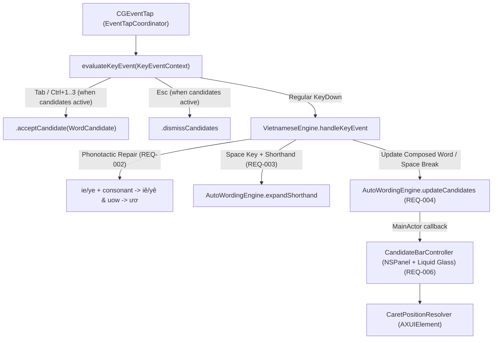

# Architecture Design: Experimental Auto Wording, Phonotactic Grammar Repair & Predictive Candidate Bar (`2026-10-26-auto-wording`)

## 1. Component Architecture (`REQ-001`..`REQ-006`)



---

## 2. Configuration & Store Design (`REQ-001`)

- **[MODIFY] `Sources/OpenKey/macOS-Swift/Sources/OpenKeySwiftCore/OpenKeySettingsStore.swift`**:
  - Add keys in `OpenKeySettingsStore.Keys`:
    - `autoWordingEnabled = "AutoWordingEnabled"` (default `true`)
    - `grammarRepairEnabled = "GrammarRepairEnabled"` (default `true`)
    - `shorthandExpansionEnabled = "ShorthandExpansionEnabled"` (default `true`)
    - `candidateSuggestionsEnabled = "CandidateSuggestionsEnabled"` (default `true`)
  - Sync these 4 flags to `VietnameseEngine` and `AutoWordingEngine` inside `syncToEngine()`.

---

## 3. Phonotactic Syllable Repair in `VietnameseEngine.swift` (`REQ-002`, `ADR-002`)

- **[MODIFY] `Sources/OpenKey/macOS-Swift/Sources/OpenKeySwiftCore/VietnameseEngine.swift`**:
  - Add configuration properties `vAutoWordingEnabled: Int = 1`, `vGrammarRepairEnabled: Int = 1`, `vShorthandExpansionEnabled: Int = 1`, `vCandidateSuggestionsEnabled: Int = 1`.
  - **Rule 1 (`ie`/`ye` + Final Consonant → `iê`/`yê`)**:
    - Introduce `repairPhonotacticClusterIfNeeded()` called before `checkSpelling()` and inside `checkGrammar()`:
    - When `vAutoWordingEnabled != 0 && vGrammarRepairEnabled != 0` and `index >= 3`:
      - Locate the vowel span `VSI...VEI` and confirm there is at least one final consonant after `VEI` (`Int(index) - 1 > VEI` and `isConsonant(chr(VEI + 1))`).
      - If the vowel span ends with `(chr(VEI - 1) == KEY_I || chr(VEI - 1) == KEY_Y) && chr(VEI) == KEY_E` and `(typingWord[VEI] & TONE_MASK) == 0`:
        - Set `typingWord[VEI] |= TONE_MASK`, set `isChanged = true`, and recompute `hBPC`, `hNCC`, and `hData` so `tiengs` immediately transforms into `tiếng` and `viets` transforms into `viết`.
  - **Rule 2 (`uow`/`uwo` + Final Consonant → `ươ`)**:
    - When `vAutoWordingEnabled != 0 && vGrammarRepairEnabled != 0`, if the vowel span contains `KEY_U` followed by `KEY_O` before a final consonant (`Int(index) - 1 > VEI`) and either `KEY_U` or `KEY_O` has `TONEW_MASK` while the other does not, apply `TONEW_MASK` to both `KEY_U` and `KEY_O` (`ư` + `ơ`).

---

## 4. `VietnameseDictionary.swift` & `AutoWordingEngine.swift` (`REQ-003`, `REQ-004`, `ADR-001`)

- **[NEW] `Sources/OpenKey/macOS-Swift/Sources/OpenKeySwiftCore/VietnameseDictionary.swift`**:
  - Provides a `>= 5,000`-entry Vietnamese reference dictionary in Pure Swift 6:
    - **Single-Syllable Lexicon (`>= 3,500` syllables)**: Combines a priority-ranked core vocabulary of the ~1,200 most frequent Vietnamese syllables with systematic phonotactically valid Vietnamese syllables (`onset + valid rime + tone`) so rare and common Vietnamese syllables alike are recognized.
    - **Two-Syllable Compound Dictionary (`>= 1,500` compounds)**: Covers everyday communication, technology/software, business/finance, education/science, geography, administration, health, and culture.
    - **In-Memory Startup Indices**:
      1. `syllableSet: Set<String>` (`>= 3,500` lowercase valid Vietnamese syllables).
      2. `stemToWords: [String: [String]]` (unaccented ASCII stem with `đ`→`d` stripped → frequency-ordered accented words).
      3. `telexSignatureToWords: [String: [String]]` (sorted ASCII character signature of both plain stem and Telex keystroke sequence → valid words, enabling O(1) recovery of transposed Telex input like `"tineg"`, `"veit"`, `"ngheing"`, `"taonf"`, `"hcinh"`, `"turyen"`).
      4. `compoundBigrams: [String: [String]]` (head syllable → ordered list of compound continuation syllables).

- **[NEW] `Sources/OpenKey/macOS-Swift/Sources/OpenKeySwiftCore/AutoWordingEngine.swift`**:
  - Defines:
    ```swift
    public enum CandidateKind: String, Sendable, Equatable {
        case correction
        case nextWord
    }

    public struct WordCandidate: Sendable, Equatable, Identifiable {
        public let id: Int
        public let text: String
        public let kind: CandidateKind
        public let replaceLength: Int
    }
    ```
  - **Shorthand Expansion Table (`REQ-003`)**:
    - Maps lowercase shorthand keys (`"ko"`, `"dc"`, `"đc"`, `"trc"`, `"ng"`, `"nhg"`, `"vs"`, `"ntn"`, `"bt"`, `"cx"`, `"mk"`, `"vn"`, `"hn"`, `"tphcm"`, `"hcm"`) to their expanded Vietnamese strings, preserving initial-caps (`"Ko"` → `"Không"`) or all-caps (`"KO"` → `"KHÔNG"`).
  - **Current-Word Wrong-Syntax & Stem Correction (`REQ-004`)**:
    - `computeCurrentWordCandidates(rawAscii: String, composedText: String, isWrongSpelling: Bool) -> [WordCandidate]`
    - Checks:
      1. Direct transposition / typo lookup and Damerau-Levenshtein distance-1 against raw Telex stems (e.g., `"tineg"` → `["tiếng", "tiêng", "tiện"]`, `"veit"` → `["việt", "viết", "viên"]`, `"ngheing"` → `["nghiêng", "nghiên", "nghiệm"]`, `"taonf"` → `["toàn", "toán", "toan"]`, `"hcinh"` → `["chính", "chỉnh", "trình"]`).
      2. Unaccented / ambiguous Vietnamese syllable stem lookup when the user types an unaccented or partially accented syllable (e.g., `"thanh"` → `["thành", "thánh", "thanh"]`, `"duoc"` → `["được", "dược", "duộc"]`, `"nguoi"` → `["người", "ngươi", "nguôi"]`, `"chao"` → `["chào", "cháo", "chao"]`, `"viet"` → `["Việt", "viết", "việt"]`, `"cam"` → `["cảm", "cam", "cầm"]`).
  - **Predictive Compound Next-Word Table (`REQ-004`)**:
    - `computeNextWordCandidates(previousWord: String) -> [WordCandidate]`
    - Looks up `previousWord.lowercased()` in `compoundBigramTable: [String: [String]]` (~150+ common Vietnamese head syllables, each mapped to 3 high-frequency compound continuations, e.g. `"thành": ["phố", "công", "viên"]`, `"nghiên": ["cứu", "ngẫm", "túc"]`, `"phát": ["triển", "hiện", "hành"]`, `"công": ["việc", "nghệ", "ty"]`, `"hệ": ["thống", "quả", "số"]`, `"chương": ["trình", "mục", "khoản"]`, `"ứng": ["dụng", "viên", "xử"]`, `"thông": ["tin", "báo", "minh"]`, `"dữ": ["liệu", "dội", "dằn"]`, `"trí": ["tuệ", "nhớ", "thức"]`, `"phần": ["mềm", "cứng", "lớn"]`, `"điện": ["thoại", "tử", "lực"]`, `"máy": ["tính", "chủ", "móc"]`).

---

## 5. Event-Tap Candidate Selection & Floating Liquid Glass Pill (`REQ-005`, `REQ-006`, `ADR-003`, `ADR-004`)

- **[MODIFY] `Sources/OpenKey/macOS-Swift/Sources/OpenKeySwiftCore/EventTapCoordinator.swift`**:
  - Extend `EventTapAction` with:
    - `.acceptCandidate(WordCandidate)`
    - `.dismissCandidates`
  - Extend `KeyEventContext` with `autoWordingEnabled: Bool`, `candidateSuggestionsEnabled: Bool`, and `activeCandidates: [WordCandidate]`.
  - In `evaluateKeyEvent(_ context: KeyEventContext)`:
    - When `context.language == 1 && context.autoWordingEnabled && context.candidateSuggestionsEnabled && !context.activeCandidates.isEmpty && context.eventType == .keyDown`:
      - If `context.keyCode == Int64(KEY_TAB)` and no Command/Control/Option flags: return `.acceptCandidate(context.activeCandidates[0])`.
      - If `context.flags.contains(.maskControl)` and `!context.flags.contains(.maskCommand)` and `!context.flags.contains(.maskAlternate)`:
        - `KEY_1` (`18`) → index `0`, `KEY_2` (`19`) → index `1`, `KEY_3` (`20`) → index `2`; if `< context.activeCandidates.count`, return `.acceptCandidate(context.activeCandidates[idx])`.
      - If `context.keyCode == Int64(KEY_ESC)`: return `.dismissCandidates`.
- **[NEW] `Sources/OpenKey/macOS-Swift/Sources/OpenKeySwiftApp/CandidateBarController.swift`**:
  - `@MainActor public final class CandidateBarController`:
    - Observes `AutoWordingEngine.shared.onCandidatesChanged`.
    - Creates a borderless, non-activating `NSPanel` (`styleMask: [.borderless, .nonactivatingPanel]`, `level: .popUpMenu`) hosting `CandidateBarView`.
    - `CandidateBarView` renders up to 3 candidate buttons inside a `.glassEffect(.regular, in: .capsule)` container.
    - `CaretPositionResolver.resolveCaretScreenPoint()` queries `AXUIElementCopyParameterizedAttributeValue` (`kAXBoundsForRangeParameterizedAttribute`) on the focused Accessibility element and converts top-left quartz screen coordinates to Cocoa bottom-left screen coordinates, falling back to `NSEvent.mouseLocation` when unavailable.
