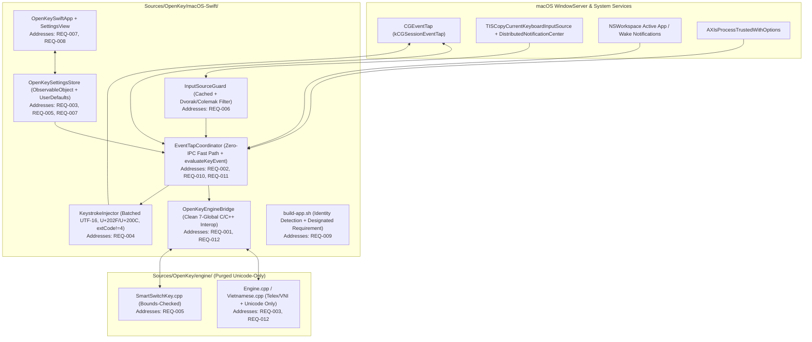

# Architecture & Technical Design (`2026-10-26-macos-swift-ime`)

- **Feature ID**: `2026-10-26-macos-swift-ime`
- **Traceability**: `REQ-001`, `REQ-002`, `REQ-003`, `REQ-004`, `REQ-005`, `REQ-006`, `REQ-007`, `REQ-008`, `REQ-009`, `REQ-010`, `REQ-011`, `REQ-012`, `REQ-013`

---

## 1. System Architecture Overview



---

## 2. Component Design & Requirement Mapping

### 2.1 Project Layout & C++/Swift Bridging (`Addresses: REQ-001`, `REQ-012`)
- `Sources/OpenKey/macOS-Swift/` compiles `OpenKeyEngineBridge`, `OpenKeySwiftCore`, `OpenKeySwiftApp`, and `OpenKeySwiftTests`.
- `Sources/OpenKey/engine/` contains strictly:
  - `DataType.h`
  - `Engine.h` & `Engine.cpp`
  - `Vietnamese.h` & `Vietnamese.cpp`
  - `SmartSwitchKey.h` & `SmartSwitchKey.cpp`
  - (`ConvertTool.h/.cpp` and `Macro.h/.cpp` are deleted).
- `OpenKeyEngineBridge.mm` defines strictly the 7 active globals (`vLanguage`, `vInputType`, `vCheckSpelling`, `vUseModernOrthography`, `vRestoreIfWrongSpelling`, `vFixRecommendBrowser`, `vUseSmartSwitchKey`) and includes only `Engine.cpp`, `Vietnamese.cpp`, and `SmartSwitchKey.cpp`.

### 2.2 Unsandboxed `CGEventTap` Lifecycle, Wake Recovery & Self-Event Tagging (`Addresses: REQ-002`)
- `OpenKeySwift.entitlements` omits `com.apple.security.app-sandbox`.
- `EventTapCoordinator` polls `AXIsProcessTrusted()` every `1.0s` until granted, then registers a session-level `CGEventTap` for `.keyDown`, `.keyUp`, `.flagsChanged`, `.leftMouseDown`, and `.rightMouseDown`.
- Subscribes to `NSWorkspace.shared.notificationCenter.publisher(for: NSWorkspace.didWakeNotification)` to re-enable `eventTap` and call `OKEngineResetSession()` after system sleep/wake.
- Self-injected events use `CGEventSource(stateID: .privateState)` tagged with `0xBEEF` (`KeystrokeInjector.eventSourceUserData`).

### 2.3 Purged C++ Engine: Telex & VNI, Precomposed Unicode Only & Auto-Restore (`Addresses: REQ-003`, `REQ-012`)
- `DataType.h` defines `enum vInputType { vTelex = 0, vVNI }` and `enum vKeyHookCodeState { vDoNothing = 0, vWillProcess, vBreakWord, vRestore, vRestoreAndStartNewSession }` (removing `vSimpleTelex1`, `vSimpleTelex2`, `vReplaceMaro`, and `IS_QUICK_TELEX_KEY`).
- `Vietnamese.h` and `Vietnamese.cpp` replace `map<Uint32, vector<Uint16>> _codeTable[]` with a single `map<Uint32, vector<Uint16>> _codeTable` containing strictly Precomposed Unicode code points, removing `TCVN3`, `VNI Windows`, `Unicode Compound`, `CP 1258`, `_unicodeCompoundMark`, `_quickTelex`, `_quickStartConsonant`, and `_quickEndConsonant`.
- `Engine.h` and `Engine.cpp` remove all dead `extern int` globals (`vFreeMark`, `vCodeTable`, `vQuickTelex`, `vUseMacro`, `vUseMacroInEnglishMode`, `vAutoCapsMacro`, `vUpperCaseFirstChar`, `vTempOffSpelling`, `vAllowConsonantZFWJ`, `vQuickStartConsonant`, `vQuickEndConsonant`, `vRememberCode`, `vTempOffOpenKey`) and dead functions/branches (`handleQuickTelex`, `checkQuickConsonant`, `upperCaseFirstCharacter`, `isMacroBreakCode`, `_macroBreakCode`, `hMacroKey`, `hMacroData`).

### 2.4 Spotlight, Terminal & VM Bypass, and App-Aware Autocomplete Fix (`Addresses: REQ-004`, `REQ-010`)
- **Terminal & VM/Remote-Desktop Bypass (`isTerminalApp`)**:
  - Matches terminal emulators (`com.apple.Terminal`, `com.googlecode.iterm2`, `dev.warp.Warp-Stable`, `dev.warp.Warp`, `com.mitchellh.ghostty`, `org.alacritty`, `io.alacritty`, `net.kovidgoyal.kitty`, `co.zeit.hyper`, `com.github.wez.wezterm`) and raw-keycode VM/remote-desktop apps (`com.vmware.fusion`, `com.parallels.desktop.console`, `com.microsoft.rdc.macos`, `org.virtualbox.app.VirtualBoxVM`, `com.utmapp.UTM`).
- **Accurate, Cached Spotlight Overlay Detection (`isSpotlightOverlayVisible`)**:
  - Checks `frontmostBundleId?.hasPrefix("com.apple.Spotlight") == true`.
  - Uses a `0.15s` monotonic timestamp cache (`CFAbsoluteTimeGetCurrent()`) invalidated whenever `Cmd + Space` (`keyCode == 49` with `.maskCommand`) is pressed or `handleAppSwitch` fires.
  - When querying `CGWindowListCopyWindowInfo([.optionOnScreenOnly, .excludeDesktopElements], kCGNullWindowID)`, requires `kCGWindowOwnerName == "Spotlight"`, `kCGWindowLayer > 0`, and window bounds (`kCGWindowBounds`) with `Width >= 200 && Height >= 40` so small status-bar items never trigger a false positive.
- **App-Aware `KeystrokeInjector.determineStrategy`**:
  ```swift
  public static let zeroWidthNonJoiner: UInt16 = 0x200C // Sublime Text
  public static let narrowNoBreakSpace: UInt16 = 0x202F // Default browsers/IDEs

  public static func determineStrategy(
      backspaceCount: Int,
      fixRecommendBrowser: Bool,
      bundleId: String? = nil,
      extCode: UInt8 = 0
  ) -> ReplacementStrategy {
      guard backspaceCount > 0, fixRecommendBrowser, extCode != 4 else {
          return .standardBackspace
      }
      if let bundleId = bundleId, bundleId.hasPrefix("com.sublimetext.") {
          return .emptyCharBreaker(emptyChar: zeroWidthNonJoiner)
      }
      return .emptyCharBreaker(emptyChar: narrowNoBreakSpace)
  }
  ```

### 2.5 Configurable Per-App Smart Switch (Remember Per App vs Global Mode) & Bounds-Checked Deserialization (`Addresses: REQ-005`, `REQ-008`)
- `OpenKeySettingsStore` persists `useSmartSwitchKey` (default `true`) and per-app language changes via `OKSetAppInputMethodStatus` and `OKGetSmartSwitchKeySaveData` into `UserDefaults` (`SmartSwitchData`), ignoring `"com.tuyenmai.openkey.swift"` and terminal/VM apps.
- When `useSmartSwitchKey` is toggled from `false` to `true`, `OpenKeySettingsStore.useSmartSwitchKey.didSet` immediately records the current `language` for `activeAppBundleId` via `OKSetAppInputMethodStatus` and `saveSmartSwitchData()` so the active app retains the current language.
- When `useSmartSwitchKey == false`, `EventTapCoordinator.handleAppSwitch` resets the engine session (`OKEngineResetSession()`) and updates `activeAppBundleId` without changing `settings.language` (global language mode).
- Surfaced as a checkable menu item (`"Nhớ ngôn ngữ theo ứng dụng"`) in `OpenKeySwiftApp` and in the top `"Bộ gõ & Ngôn ngữ (Input & Language)"` group box of `SettingsView`.
- `SmartSwitchKey.cpp` enforces `cursor + bundleIdSize + 1 <= size` bounds checks.

### 2.6 Notification-Cached Keyboard Layout Guard with Non-QWERTY Exclusion (`Addresses: REQ-006`)
- `InputSourceGuard` registers a `DistributedNotificationCenter.default()` observer for `String(kTISNotifySelectedKeyboardInputSourceChanged)` on first use to invalidate its cached `Bool` result.
- `isCompatibleInputSource(language: String?, inputSourceID: String?) -> Bool` verifies:
  1. `language` starts with `"en"` (case-insensitive).
  2. `inputSourceID` does not contain `"dvorak"`, `"colemak"`, or `"azerty"` (case-insensitive).

### 2.7 Toggle Shortcut State Machine (`Option + Z` Default, Auto-Repeat Filter, KeyUp Swallow, Modifier-Only Tap) (`Addresses: REQ-007`, `REQ-011`)
- **Key+Modifier Shortcut (`keyCode != 0xFE`)**:
  - On `.keyDown` matching `switchKeyStatus`:
    - Records `swallowedHotKeyCode = keyCode`.
    - If `isAutoRepeat == false`, returns `.toggleLanguageAndSwallow`; if `isAutoRepeat == true`, returns `.swallow` (no repeated language toggling while held).
  - On `.keyUp` where `keyCode == swallowedHotKeyCode`:
    - Clears `swallowedHotKeyCode = nil` and returns `.swallow` so the active app never sees an orphaned `keyUp`.
- **Modifier-Only Shortcut (`keyCode == 0xFE`)**:
  - On `.flagsChanged`:
    - If `HotKeyMatcher.matches(keyCode: 0xFE, flags: flags, config: switchKeyStatus)`, sets `pendingModifierTap = true`.
    - Else if `pendingModifierTap == true` and all four modifier flags (`.maskControl`, `.maskAlternate`, `.maskCommand`, `.maskShift`) are now cleared, clears `pendingModifierTap = false` and returns `.toggleLanguageAndSwallow`.
    - Else if other modifiers were added, clears `pendingModifierTap = false`.
  - On any `.keyDown`, `.leftMouseDown`, or `.rightMouseDown`, clears `pendingModifierTap = false` so modifier chords (e.g. `⌃⌥←`) never trigger a language toggle on release.

### 2.8 Cached Monochrome Status Icons, `@Observable` Store & macOS 26 Liquid Glass `SettingsView` (`Addresses: REQ-008`, `REQ-013`)
- **`@Observable` State Management (`OpenKeySettingsStore.swift`)**:
  - Annotated with `@Observable public final class OpenKeySettingsStore`, removing `ObservableObject`, `@Published`, and `import Combine`.
  - Provides `public var onLanguageChanged: ((Int) -> Void)?` invoked whenever `language` changes so `OpenKeySwiftApp` updates `statusItem?.button?.image` in O(1) without `Combine` or `UserDefaults.didChangeNotification`.
- **Cached Status Icons in `OpenKeySwiftApp.swift`**:
  - Pre-builds `private lazy var vietnameseIcon = makeStatusIcon(isVietnamese: true)` and `private lazy var englishIcon = makeStatusIcon(isVietnamese: false)`.
  - Includes a checkable `"Nhớ ngôn ngữ theo ứng dụng"` menu item bound to `settings.useSmartSwitchKey`.
- **macOS 26 Liquid Glass & Grouped `Form` in `SettingsView.swift`**:
  - Uses `@Bindable var settings = OpenKeySettingsStore.shared` and `Form { Section(...) { ... } } .formStyle(.grouped)`.
  - Styles the Accessibility status header with `.glassEffect(.regular, in: .rect(cornerRadius: 12))` and the shortcut display pill with `.glassEffect(.regular, in: .capsule)`.
  - Adds a `"Đổi phím tắt..."` / `"Nhấn tổ hợp phím (Esc để hủy)..."` recording button using `NSEvent.addLocalMonitorForEvents(matching: [.keyDown, .flagsChanged])`.
  - Uses modern 2-parameter `.onChange(of: settings.launchAtLogin) { _, newValue in ... }` and displays any `SMAppService.mainApp` error inline while rolling back `settings.launchAtLogin` to `SMAppService.mainApp.status == .enabled`.

### 2.9 Stable Code-Signing Identity & Designated Requirement in `build-app.sh` (`Addresses: REQ-009`)
- `build-app.sh` supports:
  - Optional `--setup-cert` flag to generate a self-signed code-signing certificate (`OpenKey Local Signer`) in the login keychain if none exists.
  - Auto-detection of `CODESIGN_IDENTITY` or the first valid identity from `security find-identity -v -p codesigning` (falling back to `-` if none exists).
  - Signing with `--identifier com.tuyenmai.openkey.swift -r='designated => identifier "com.tuyenmai.openkey.swift"'`.

### 2.10 Zero-IPC Hot-Path Ordering & Pure Testable `evaluateKeyEvent` (`Addresses: REQ-010`, `REQ-011`)
- `EventTapCoordinator` defines `EventTapEventType`, `KeyEventContext`, and `EventTapAction` and executes `evaluateKeyEvent(_ context: KeyEventContext) -> EventTapAction` in strict O(1)-first order so modifier shortcuts, non-`keyDown` events, and English mode (`settings.language == 0`) return before any app, Spotlight, or layout check.

---

## 12. 100% Pure Swift 6 Vietnamese Engine Conversion & Provenance Attribution (`REQ-014`, `REQ-015`, `ADR-011`)

### 12.1 Pure Swift 6 Engine Architecture (`OpenKeySwiftCore`)
- **`VietnameseData.swift` (`REQ-014`, `REQ-015`)**:
  - Contains explicit provenance header crediting Mai Vũ Tuyên's original `OpenKey` (`DataType.h`, `mac.h`, `Vietnamese.h/.cpp`).
  - Defines `OKHookSnapshot` as a native Swift value type (`public struct OKHookSnapshot: Sendable, Equatable`) with `code: UInt8`, `backspaceCount: UInt8`, `newCharCount: UInt8`, `extCode: UInt8`, `shouldSendControlKey: Bool`, and `utf16Chars: [UInt16]`.
  - Defines all macOS virtual keycodes (`KEY_ESC`..`KEY_SLASH`), bitmasks (`CAPS_MASK`, `TONE_MASK`, `TONEW_MASK`, `MARK1_MASK`..`MARK5_MASK`, `MARK_MASK`, `CHAR_MASK`, `STANDALONE_MASK`, `CHAR_CODE_MASK`, `PURE_CHARACTER_MASK`, `END_CONSONANT_MASK`, `CONSONANT_ALLOW_MASK`), and phonotactic tables (`douKey`, `_vowel`, `_vowelCombine`, `_vowelForMark`, `_consonantD`, `_consonantTable`, `_endConsonantTable`, `_standaloneWbad`, `_doubleWAllowed`, `_codeTable`, `_characterMap`, `keyCodeToCharacter(_:)`).
- **`VietnameseEngine.swift` (`REQ-014`, `REQ-015`)**:
  - Contains explicit provenance header crediting Mai Vũ Tuyên's original `OpenKey` (`Engine.h/.cpp`, `SmartSwitchKey.h/.cpp`).
  - Implements the complete Vietnamese Telex/VNI syllable composition state machine in pure Swift 6 (`vKeyInit`, `vKeyHandleEvent`, `startNewSession`, `checkSpelling`, `findAndCalculateVowel`, `checkGrammar`, `handleModernMark`, `handleOldMark`, `insertMark`, `insertD`, `insertAOE`, `insertW`, `checkForStandaloneChar`, `removeMark`, `checkRestoreIfWrongSpelling`, `saveWord`, `restoreLastTypingState`, and `SmartSwitchKey` binary serialization/deserialization with bounds checking).
  - Exposes pure Swift public functions (`OKEngineInit`, `OKEngineSyncConfig`, `OKEngineHandleKeyEvent`, `OKEngineResetSession`, `OKEngineKeyCodeToChar`, `OKInitSmartSwitchKey`, `OKGetAppInputMethodStatus`, `OKSetAppInputMethodStatus`, `OKGetSmartSwitchKeySaveData`).
- **`Package.swift` Simplification (`REQ-014`)**:
  - Removes `OpenKeyEngineBridge` target and `cxxLanguageStandard: .cxx17`, leaving strictly `OpenKeySwiftCore`, `OpenKeySwiftApp`, and `OpenKeySwiftTests`.

### 12.2 Conversion Provenance & Attribution (`REQ-015`)
- **`SettingsView.swift`**:
  - Adds a dedicated `"Giới thiệu (About)"` section at the bottom of the grouped `Form` clearly stating:
    - `"OpenKeySwift — Bản chuyển đổi 100% Pure Swift 6 (macOS 26)"`
    - `"Được chuyển đổi hoàn toàn sang ngôn ngữ Swift 6 từ bộ gõ mã nguồn mở OpenKey (C++/Objective-C++) của tác giả Mai Vũ Tuyên."`
- **`OpenKeySwiftApp.swift`**:
  - Adds an informational item `"Chuyển đổi Pure Swift 6 từ OpenKey (Mai Vũ Tuyên)"` in the status bar menu.
- **`Info.plist` & `README.md`**:
  - Updates `NSHumanReadableCopyright` in `Info.plist` and adds a top-level callout in `README.md` documenting the 100% Pure Swift 6 conversion from `OpenKey`.
