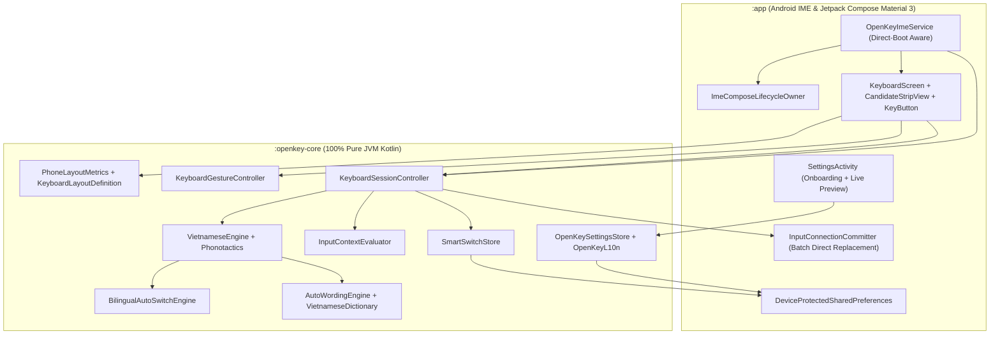

# Architecture & Design Blueprint: Native Android Vietnamese Keyboard for Large-Screen Phones (`2026-11-02-android-large-phone-keyboard`)

---

## 1. Requirement-to-Component Traceability Matrix

| Requirement ID | ADR | Target Files | Component / Method |
| :--- | :--- | :--- | :--- |
| **`REQ-001`** | `ADR-001` | `Sources/OpenKey/android/settings.gradle.kts`, `Sources/OpenKey/android/build.gradle.kts`, `Sources/OpenKey/android/openkey-core/build.gradle.kts`, `Sources/OpenKey/android/app/build.gradle.kts`, `Sources/OpenKey/android/app/src/main/AndroidManifest.xml`, `Sources/OpenKey/android/app/src/main/res/xml/method.xml` | Multi-module Gradle setup (`:openkey-core` pure JVM + `:app` Android Compose), `minSdk = 29`, `targetSdk = 35`, `android:directBootAware="true"`, zero `INTERNET` permission |
| **`REQ-002`** | `ADR-002` | `Sources/OpenKey/android/openkey-core/src/main/kotlin/com/tuyenmai/openkey/core/VietnameseData.kt`, `VietnameseEngine.kt`, `VietnameseEnginePhonotactics.kt` | `VietnameseEngineState`, `handleKeyEvent(...)`, `findAndCalculateVowel(forGrammar:)`, `canHasEndConsonant()`, `checkCorrectVowel(...)`, `handleModernMark()`, `insertMark(...)`, `checkRestoreIfWrongSpelling(...)`, `CHR(idx)` |
| **`REQ-003`** | `ADR-003` | `Sources/OpenKey/android/openkey-core/src/main/kotlin/com/tuyenmai/openkey/core/VietnameseDictionary.kt`, `BilingualAutoSwitchEngine.kt` | `BilingualAutoSwitchEngine`, `reconstructedRawKeys()`, `droppedKeys`, `canonicalTelexKey(for:)`, `evaluateWordOnSpace(...)`, `evaluateTwoWordLookback(...)` |
| **`REQ-004`** | `ADR-004` | `Sources/OpenKey/android/openkey-core/src/main/kotlin/com/tuyenmai/openkey/core/AutoWordingEngine.kt` | `AutoWordingEngine`, `OKWordContext`, `Candidate`, `CandidateKind`, `computeCurrentWordCandidates(...)`, `computeNextWordCandidates(...)`, `recordCandidateAcceptance(text)`, `expandShorthand(rawWord)`, `repairPhonotacticCluster(...)` |
| **`REQ-005`** | `ADR-005` | `Sources/OpenKey/android/openkey-core/src/main/kotlin/com/tuyenmai/openkey/core/InputContextEvaluator.kt`, `Sources/OpenKey/android/app/src/main/java/com/tuyenmai/openkey/android/ime/InputConnectionCommitter.kt`, `OpenKeyImeService.kt` | `InputContextEvaluator.evaluate(...)`, `InputConnectionCommitter.applyEngineOutput(...)`, `beginBatchEdit()`, `deleteSurroundingText(...)`, `commitText(...)`, `endBatchEdit()`, `onUpdateSelection(...)` |
| **`REQ-006`** | `ADR-006` | `Sources/OpenKey/android/openkey-core/src/main/kotlin/com/tuyenmai/openkey/core/SmartSwitchStore.kt`, `Sources/OpenKey/android/app/src/main/java/com/tuyenmai/openkey/android/ime/OpenKeyImeService.kt` | `SmartSwitchStore.getAppInputMethodStatus(packageName, currentLanguage)`, `SmartSwitchStore.setAppInputMethodStatus(packageName, language)`, `onStartInputView(...)` |
| **`REQ-007`** | `ADR-007`, `ADR-015` | `Sources/OpenKey/android/openkey-core/src/main/kotlin/com/tuyenmai/openkey/core/PhoneLayoutMetrics.kt`, `KeyboardLayoutDefinition.kt`, `Sources/OpenKey/android/app/src/main/java/com/tuyenmai/openkey/android/ui/KeyboardScreen.kt`, `CandidateStripView.kt` | `PhoneLayoutMetrics.compute(...)`, `PhoneLayoutConfig`, `OneHandedMode` (`OFF`, `LEFT`, `RIGHT`), `KeyboardLayer` (`QWERTY`, `SYMBOLS_1`, `SYMBOLS_2`), `heightScalePercent`, `bottomChinPaddingDp`, landscape auto-compact |
| **`REQ-008`** | `ADR-008` | `Sources/OpenKey/android/openkey-core/src/main/kotlin/com/tuyenmai/openkey/core/KeyboardGestureController.kt`, `Sources/OpenKey/android/app/src/main/java/com/tuyenmai/openkey/android/ui/KeyButton.kt` | `KeyboardGestureController.onSpacebarDrag(...)`, `onBackspaceDrag(...)`, `resolveLongPressVariants(key)`, `GestureAction` (`CursorMove`, `DeletePreviousWord`, `ShowLongPressPopup`) |
| **`REQ-009`** | `ADR-009`, `ADR-015` | `Sources/OpenKey/android/openkey-core/src/main/kotlin/com/tuyenmai/openkey/core/KeyboardSessionController.kt`, `Sources/OpenKey/android/app/src/main/java/com/tuyenmai/openkey/android/ime/OpenKeyImeService.kt` | Touch-only phone scope: absence of `HardwareKeyMapper.kt`, `onHardwareKeyDown`, `onHardwareKeyUp`, and `processHardwareKey` |
| **`REQ-010`** | `ADR-010` | `Sources/OpenKey/android/openkey-core/src/main/kotlin/com/tuyenmai/openkey/core/OpenKeySettingsStore.kt`, `OpenKeyL10n.kt`, `Sources/OpenKey/android/app/src/main/java/com/tuyenmai/openkey/android/settings/SettingsActivity.kt`, `Sources/OpenKey/android/app/src/main/java/com/tuyenmai/openkey/android/ime/ImeComposeLifecycleOwner.kt` | `OpenKeySettingsStore`, `KeyValueStorage`, `OpenKeyL10n`, `SettingsActivity`, `ImeComposeLifecycleOwner`, Direct-Boot storage |
| **`REQ-011`** | `ADR-011` | `Sources/OpenKey/android/openkey-core/src/main/kotlin/com/tuyenmai/openkey/core/KeyboardSessionController.kt`, `InputContextEvaluator.kt`, `Sources/OpenKey/android/app/src/main/java/com/tuyenmai/openkey/android/ime/OpenKeyImeService.kt`, `Sources/OpenKey/android/app/src/main/java/com/tuyenmai/openkey/android/ui/KeyboardScreen.kt` | `KeyboardSessionController`, `EditorUiState`, `onStartInput(...)`, `onKeyAction(...)`, `InputEvaluation.imeActionId`, `InputEvaluation.shouldSendNewlineOnEnter` |
| **`REQ-012`** | `ADR-012` | `Sources/OpenKey/android/openkey-core/src/main/kotlin/com/tuyenmai/openkey/core/KeyboardSessionController.kt`, `VietnameseEngine.kt`, `AutoWordingEngine.kt`, `VietnameseDictionary.kt` | Commit-first keystroke pipeline (`handleKeyEventFast` -> `commitBatch` -> `didProcessKeyEvent`), `VietnameseDictionary.prewarmAsync()`, static `DIACRITIC_STRIP_MAP`/`TELEX_BASE_MOD_MAP`, `AutoWordingEngine.asyncCandidateExecutionEnabled` & generation counter |
| **`REQ-013`** | `ADR-013` | `Sources/OpenKey/android/openkey-core/src/main/kotlin/com/tuyenmai/openkey/core/BatchReplacementCoordinator.kt`, `Sources/OpenKey/android/app/src/main/java/com/tuyenmai/openkey/android/ime/InputConnectionCommitter.kt` | `BatchReplacementCoordinator.currentSelStart` / `hasKnownSelection`, `InputConnectionCommitter.moveCursorBy(...)` zero-`getExtractedText` IPC cursor movement |
| **`REQ-014`** | `ADR-014` | `Sources/OpenKey/android/openkey-core/src/main/kotlin/com/tuyenmai/openkey/core/KeyboardLayoutDefinition.kt`, `Sources/OpenKey/android/app/src/main/java/com/tuyenmai/openkey/android/ui/KeyboardScreen.kt`, `KeyButton.kt` | `KeyboardLayoutDefinition` `layerCache` (`ConcurrentHashMap`), `LiveCandidateStripHost` state isolation, `KeyButton` single-pass `Modifier.drawBehind` keycap renderer |
| **`REQ-015`** | `ADR-012` | `Sources/OpenKey/android/openkey-core/src/test/kotlin/com/tuyenmai/openkey/core/SmoothArchitectureTest.kt` | 1,000-keystroke continuous mixed Vietnamese/English hot-path latency benchmark (`< 0.2ms`/keystroke average) |
| **`REQ-016`** | `ADR-016` | `.github/workflows/android-ci.yml`, `Sources/OpenKey/android/gradle.properties`, `Sources/OpenKey/android/.gitignore` | GitHub Actions Android CI/CD workflow (`ubuntu-latest`, JDK 21, `:openkey-core:test`, `:app:testDebugUnitTest`, `:app:assembleDebug`, APK artifact upload) & portable Gradle config |

---

## 2. System Architecture Diagram



---

## 3. Detailed Component Design

### 3.1 `:openkey-core` Module (`REQ-001`, `REQ-002`, `REQ-003`, `REQ-004`, `ADR-001`..`ADR-004`)

#### 3.1.1 `VietnameseData.kt`, `VietnameseEngine.kt`, `VietnameseEnginePhonotactics.kt` (`REQ-002`, `ADR-002`)
- **Bitmask & Key Constants (`VietnameseData.kt`)**:
  - Port all key constants (`KEY_A`..`KEY_Z`, `KEY_0`..`KEY_9`, `KEY_SPACE = 49u`, `KEY_DELETE = 51u`, `KEY_RETURN = 36u`, `KEY_TAB = 48u`, `KEY_LEFT_BRACKET = 33u`, `KEY_RIGHT_BRACKET = 30u`, `KEY_EMPTY = 256u`) and bitmasks (`CAPS_MASK = 0x10000u`, `TONE_MASK = 0x20000u`, `TONEW_MASK = 0x40000u`, `MARK1_MASK = 0x80000u` .. `MARK5_MASK = 0x800000u`, `MARK_MASK = 0xF80000u`, `CHAR_MASK = 0xFFFFu`, `STANDALONE_W_MASK = 0x1000000u`, `AUTO_TONE_MASK = 0x2000000u`).
  - Provide inline `UInt` bitmask properties (`baseKey`, `isCaps`, `hasToneMark`, `toneMark`, `hasCircumflexOrStroke`, `hasHornOrBreve`, `hasAnyDiacritic`, `isAutoTone`, `isStandaloneW`).
  - Include the complete precomposed Unicode lookup table (`codeTable: Map<UInt, UIntArray>`), `_vowel`, `_vowelCombine`, `_vowelForMark`, `_consonantD`, `_consonantTable`, and `_endConsonantTable`.
- **State Machine & Phonotactics (`VietnameseEngine.kt` & `VietnameseEnginePhonotactics.kt`)**:
  - Maintain `typingWord: UIntArray(MAX_BUFF)`, `keyStates: UIntArray(MAX_BUFF)`, `droppedKeys: MutableList<DroppedKeyEntry>`, `typingStates: MutableList<TypingStateSnapshot>`, `index: Int`, `stateIndex: Int`, and `spaceCount: Int`.
  - `CHR(idx: Int): UInt`: Returns `if (idx in 0 until index && idx < MAX_BUFF) (typingWord[idx] and CHAR_MASK) else KEY_EMPTY`.
  - `findAndCalculateVowel(forGrammar: Boolean)`: Scans backward from `index - 1` down to `0`, breaking before `i` in `gi` and `u` in `qu` when `!forGrammar` (and incrementing `vowelStartIndex` for `qu`) so `"giới"` (`giowis`) computes `vowelStartIndex = 2`, emitting `backspaceCount = 2, newCharCount = 2, "ới"`.
  - `handleModernMark()` and `handleOldMark()`: Compute `vowelWillSetMark` purely without mutating `hookOutput.backspaceCount` or `hookOutput.newCharCount`; `insertMark(markMask, canModifyFlag)` only updates `hookOutput` when `canModifyFlag == true`.
  - `handleDeleteKey()`: Decrements `index` (or restores previous word from `typingStates`), clears `typingWord[index] = KEY_EMPTY`, synchronizes `stateIndex = index` and `keyStates` when all diacritics are removed, prunes `droppedKeys`, and returns `HookCodeState.DO_NOTHING` (`backspaceCount = 0, newCharCount = 0`) whenever tone position does not shift.
  - `checkRestoreIfWrongSpelling(handleCode: Int)`: Restores all raw keystrokes (via `reconstructedRawKeys()`) whenever `!spellingOK || !spellingVowelOK` and any slot in `0 until index` has `MARK_MASK`, `TONE_MASK` (including `KEY_D` / `đ`), or `TONEW_MASK`.

#### 3.1.2 `VietnameseDictionary.kt` & `BilingualAutoSwitchEngine.kt` (`REQ-003`, `ADR-003`)
- **`VietnameseDictionary.kt`**:
  - Contains the Vietnamese syllable/compound corpus, `priorityMap` (including `"giới"`, `"giỏi"`, `"giời"`, `"giờ"`, `"giữ"`, `"giữa"`, `"giúp"`, `"giải"`, `"giảm"`, `"giá"`), `englishWords`, `englishPriorityWords` (`"test"`, `"list"`, `"more"`, `"core"`, `"view"`, `"show"`, `"flow"`, `"user"`, `"vars"`, `"chars"`, `"docs"`, `"sort"`, `"port"`, `"work"`, `"word"`, `"tree"`, `"free"`, `"see"`, `"too"`, `"add"`, `"boss"`, `"pass"`, `"mix"`, `"fix"`, `"box"`, `"max"`, `"tax"`), and `englishTwoWordPhrases` (`"is good"`, `"in case"`, `"for sure"`, `"of course"`, `"in fact"`, `"at least"`, `"on time"`, `"by default"`).
  - Exposes `canonicalTelexKey(for: String)`, `isValidVietnameseSyllable(word: String)`, and `isEnglishPriorityWord(rawAscii: String)`.
- **`BilingualAutoSwitchEngine.kt`**:
  - Evaluates completed syllables on word break (`Space` or punctuation):
    1. Reconstructs full raw ASCII sequence including mid-word Telex undos from `droppedKeys` (`"cheese"` → `"cheese"`, `"deepseek"` → `"deepseek"`, `"google"` → `"google"`).
    2. Repairs doubled-tone escapes at word end (`"mixx"` → `"mix"`, `"fixx"` → `"fix"`, `"boxx"` → `"box"`).
    3. Restores standalone English priority collisions (`"test"`, `"list"`, `"more"`) and invalid diphthongs (`"more"`, `"core"`, `"case"`, `"user"`, `"pure"`, `"sure"`, `"true"`).
    4. Checks 2-word English look-back (`previousWord` + `currentWord`, e.g., `"í"` + `"good"` → restores `"is good"` with combined `backspaceCount`).

#### 3.1.3 `AutoWordingEngine.kt` (`REQ-004`, `ADR-004`)
- Lock-isolated singleton/instance (`ReentrantLock`) decoupled from `VietnameseEngine` via `OKWordContext`:
  - `didProcessKeyEvent(preContext, snapshot, postContext)`: Computes up to 3 candidates (`CandidateKind.CORRECTION`, `STEM_COMPLETION`, `NEXT_WORD`), preserving vowel modifiers (`ă, â, ê, ô, ơ, ư, đ`) and sorting by `userFrequencies[word.lowercase()] ?: 0` descending then dictionary priority.
  - `acceptCandidate(candidate, currentContext)`: Computes exact `backspaceCount` and committed text (`candidate.text + " "`), increments `userFrequencies[candidate.text.lowercase()]`, and resets the active syllable session.
  - `interceptBeforeSpace(context)`: Expands custom shorthands (`customShorthands[rawLower]`) when `shorthandExpansionEnabled == true`.

### 3.2 Android Context, Direct-Replacement Committer & Per-App Memory (`REQ-005`, `REQ-006`, `ADR-005`, `ADR-006`)

#### 3.2.1 `InputContextEvaluator.kt` (`REQ-005`, `ADR-005`)
- Pure Kotlin evaluator in `:openkey-core` accepting `EditorContext(inputType: Int, imeOptions: Int, packageName: String)` and returning `InputEvaluation(bypassVietnamese: Boolean, isSecureField: Boolean, enterActionLabel: String)`:
  - Detects password variations (`TYPE_TEXT_VARIATION_PASSWORD = 0x80`, `TYPE_TEXT_VARIATION_VISIBLE_PASSWORD = 0x90`, `TYPE_TEXT_VARIATION_WEB_PASSWORD = 0xE0`, `TYPE_NUMBER_VARIATION_PASSWORD = 0x10`), setting `isSecureField = true` and `bypassVietnamese = true`.
  - Detects URI (`0x10`), email (`0x20`, `0xD0`), filter (`0xB0`), `TYPE_TEXT_FLAG_NO_SUGGESTIONS` (`0x80000`), non-text classes (`TYPE_CLASS_NUMBER = 2`, `TYPE_CLASS_PHONE = 3`, `TYPE_CLASS_DATETIME = 4`), and terminal/remote-desktop packages (`com.termux`, `com.sonelli.juicessh`, `com.server.auditor.ssh.client`, `com.microsoft.rdc.androidx`, `com.realvnc.viewer.android`), setting `bypassVietnamese = true`.

#### 3.2.2 `InputConnectionCommitter.kt` (`REQ-005`, `ADR-005`)
- Wraps `InputConnection` calls via an interface `TextCommitterTarget` (so unit tests can verify exact batch operations on a simulated buffer without Android framework mocks):
  ```kotlin
  interface TextCommitterTarget {
      fun beginBatchEdit(): Boolean
      fun endBatchEdit(): Boolean
      fun deleteSurroundingText(beforeLength: Int, afterLength: Int): Boolean
      fun commitText(text: CharSequence, newCursorPosition: Int): Boolean
      fun sendKeyChar(char: Char): Boolean
      fun performEditorAction(actionId: Int): Boolean
      fun moveCursorBy(deltaChars: Int): Boolean
      fun deletePreviousWord(): Boolean
  }
  ```
- When `OKHookSnapshot` returns `code == HookCodeState.WILL_PROCESS` or `RESTORE_KEYSTROKES`:
  1. `target.beginBatchEdit()`
  2. If `snapshot.backspaceCount > 0`: `target.deleteSurroundingText(snapshot.backspaceCount, 0)`
  3. Commit `snapshot.committedString` (plus trailing space/punctuation if `shouldSendControlKey` or word-break char) via `target.commitText(finalText, 1)`
  4. `target.endBatchEdit()`
- Tracks `expectedCursorDelta` so `OpenKeyImeService.onUpdateSelection(oldSelStart, oldSelEnd, newSelStart, newSelEnd, candidatesStart, candidatesEnd)` distinguishes self-committed cursor advances from external user taps/selections (which immediately trigger `engine.resetSession()`).

#### 3.2.3 `SmartSwitchStore.kt` (`REQ-006`, `ADR-006`)
- Stores `Map<String, Int>` (`packageName -> language`) in `KeyValueStorage` (`"SmartSwitchData"`).
- On `onStartInputView(editorInfo, restarting)`: if `settings.useSmartSwitchKey` is `true` and `packageName` is valid, queries `SmartSwitchStore.getAppInputMethodStatus(packageName, settings.language)`:
  - If found (`0` or `1`), updates `settings.setLanguageFromSmartSwitch(savedLang)`.
  - If `-1` (first visit), records `SmartSwitchStore.setAppInputMethodStatus(packageName, settings.language)`.

### 3.3 Samsung Galaxy A37 One UI Stock Keyboard Layout & Gesture System (`REQ-007`, `REQ-008`, `ADR-007`, `ADR-008`)

#### 3.3.1 `PhoneLayoutMetrics.kt` & `KeyboardLayoutDefinition.kt` (`REQ-007`, `REQ-020`, `ADR-007`, `ADR-021`)
- Pure Kotlin phone layout calculator and Samsung One UI 6/7 key matrix definition in `:openkey-core`:
  ```kotlin
  enum class OneHandedMode { OFF, LEFT, RIGHT }
  enum class KeyboardLayer { QWERTY, SYMBOLS_1, SYMBOLS_2 }

  data class PhoneLayoutConfig(
      val screenWidthDp: Int,
      val screenHeightDp: Int,
      val isLandscape: Boolean,
      val showNumberRow: Boolean,
      val inputType: Int, // 0 = Telex, 1 = VNI (forces number row visible)
      val heightScalePercent: Int = 100, // 85..125
      val bottomChinPaddingDp: Int = 14, // 0..48, default 14dp on Galaxy A37 One UI
      val oneHandedMode: OneHandedMode = OneHandedMode.OFF
  )

  data class ComputedKeyboardMetrics(
      val candidateStripHeightDp: Float,
      val numberRowHeightDp: Float,
      val alphaRowHeightDp: Float,
      val bottomRowHeightDp: Float,
      val homeRowSideInsetFraction: Float, // 0.05f (5% left/right inset on A..L row)
      val effectiveBottomChinDp: Float,
      val totalHeightDp: Float,
      val activeGridWidthDp: Float,
      val sideGutterWidthDp: Float,
      val effectiveOneHandedMode: OneHandedMode,
      val isNumberRowVisible: Boolean,
      val keyCornerRadiusDp: Float, // 7f (Samsung One UI 6/7 keycap corner radius)
      val keyHorizontalGapDp: Float,
      val keyVerticalGapDp: Float
  )
  ```
- **Samsung Galaxy A37 Portrait One UI 6/7 Rules (`!isLandscape`)**:
  - `scale = heightScalePercent.coerceIn(85, 125) / 100f`
  - `candidateStripHeightDp = 44f * scale`
  - `isNumberRowVisible = showNumberRow || inputType == 1`
  - `numberRowHeightDp = if (isNumberRowVisible) 42f * scale else 0f`
  - `alphaRowHeightDp = 52f * scale`
  - `bottomRowHeightDp = 50f * scale`
  - `homeRowSideInsetFraction = 0.05f` (`5%` left and `5%` right padding on Row 3 `a..l`)
  - `effectiveBottomChinDp = bottomChinPaddingDp.coerceIn(0, 48).toFloat()` (default `14dp`)
  - `effectiveOneHandedMode = if (screenWidthDp >= 360) oneHandedMode else OneHandedMode.OFF`
  - `activeGridWidthDp = if (effectiveOneHandedMode == OneHandedMode.OFF) screenWidthDp.toFloat() else screenWidthDp * 0.82f`
  - `sideGutterWidthDp = screenWidthDp - activeGridWidthDp`
  - `keyCornerRadiusDp = 7f`, `keyHorizontalGapDp = 4f`, `keyVerticalGapDp = 5f`
- **Samsung One UI Bottom Row & Symbol Layers (`KeyboardLayoutDefinition.kt`)**:
  - `QWERTY` bottom row weights (`6` keys): `!#1` (`0.14f`) + `🌐` (`0.10f`, `KeyAction.SwitchLanguage`, `secondaryLabel = "VI"` / `"EN"`) + `,` (`0.09f`) + `Spacebar` (`0.42f`, label `"Tiếng Việt"` or `"English (US)"`) + `.` (`0.09f`) + `Enter` (`0.16f`).
  - `SYMBOLS_1` & `SYMBOLS_2` bottom row weights (`5` keys): `ABC` (`0.15f`) + `,` (`0.10f`) + `Spacebar` (`0.50f`) + `.` (`0.10f`) + `Enter` (`0.15f`).
  - Symbol layers: `SYMBOLS_1` (toggled via `!#1`, with `1/2` button to `SYMBOLS_2` and `ABC` button back to `QWERTY`) and `SYMBOLS_2` (with `2/2` button back to `SYMBOLS_1` and `ABC` back to `QWERTY`).
- **Landscape Auto-Compact Rules (`isLandscape`)**:
  - Uses compact base heights (`candidateStrip = 36dp`, `numberRow = 32dp`, `alphaRow = 38dp`, `bottomRow = 38dp`, `effectiveBottomChinDp = 0dp`, `effectiveOneHandedMode = OneHandedMode.OFF`), and caps `totalHeightDp <= screenHeightDp * 0.42f`.

#### 3.3.2 `KeyboardGestureController.kt` (`REQ-008`, `ADR-008`)
- Pure Kotlin gesture state machine in `:openkey-core`:
  - **Spacebar Trackpad**:
    - `onSpacebarDown()` resets drag accumulator.
    - `onSpacebarDrag(deltaDp: Float)`: Once total displacement `>= 10f`, marks `isTrackpadActive = true` and emits `CursorMove(steps)` for every `12f` dp crossed (`steps = -1` for left, `+1` for right).
    - `onSpacebarUp()`: Returns `CommitSpace` only if `!isTrackpadActive`; otherwise returns `FinishTrackpad` without inserting a space.
  - **Backspace Swipe-Delete**:
    - `onBackspaceDown()` resets drag accumulator.
    - `onBackspaceDrag(deltaDp: Float)`: For every `-24f` dp dragged leftward, marks `isSwipeDeleteActive = true` and emits `DeletePreviousWord`.
    - `onBackspaceUp()`: Returns `DeleteSingleChar` only if `!isSwipeDeleteActive`.
  - **Long-Press Variants (`resolveLongPressVariants`)**:
    - Top row `q..p` → `["1"]`..`["0"]` plus `!@#$%^&*()`.
    - Vietnamese vowel/consonant keys:
      - `'a'` → `["ă", "â", "á", "à", "ả", "ã", "ạ"]`
      - `'d'` → `["đ"]`
      - `'e'` → `["ê", "é", "è", "ẻ", "ẽ", "ẹ"]`
      - `'o'` → `["ô", "ơ", "ó", "ò", "ỏ", "õ", "ọ"]`
      - `'u'` → `["ư", "ú", "ù", "ủ", "ũ", "ụ"]`

### 3.4 Phone Touch-Only Scope & Material 3 Settings (`REQ-009`, `REQ-010`, `ADR-009`, `ADR-010`)
- **Touch-Only Phone Scope (`REQ-009`, `ADR-009`)**:
  - `HardwareKeyMapper.kt` is removed from `:openkey-core`, and `OpenKeyImeService` / `KeyboardSessionController` do not override or intercept `onKeyDown` / `onKeyUp` (`onHardwareKeyDown`, `onHardwareKeyUp`, `processHardwareKey` are removed). All keystroke routing flows exclusively through on-screen touch actions (`KeyAction`).
- **`OpenKeySettingsStore.kt`, `OpenKeyL10n.kt` & `SettingsActivity.kt` (`REQ-010`, `ADR-010`)**:
  - `OpenKeySettingsStore` persists all engine, auto-wording, and large-screen ergonomic properties via `KeyValueStorage` (backed by device-protected `SharedPreferences` on Android), clamping out-of-range inputs and cascading `autoWordingEnabled = true` to sub-toggles when all three are `false`.
  - `SettingsActivity` renders a Material 3 scrollable layout with:
    1. Header with `VI | EN` UI language pill (`OpenKeyL10n`).
    2. 2-Step Onboarding Status Card (Enable Keyboard + Select Keyboard).
    3. Live Test Input Field + Interactive Large-Screen Preview Card (Height Scale `85%–125%`, Bottom Chin `0–48dp`, One-Handed `Off / Left / Right`, Number Row toggle, Haptics & Key Preview toggles).
    4. Vietnamese Engine & Bilingual Intelligence Card (`Telex / VNI`, `Modern Orthography`, `Check Spelling`, `Auto-Restore Wrong Spelling`, `Bilingual English Auto-Restore`, `Per-App Smart Switch`).
    5. Auto Wording, Candidate Strip & Custom Shorthand Editor Card.
    6. About Card (`OpenKey Android v2.0.0`, implementor attribution `Antigravity — Gemini 4 Argon (High)`, `Zero Internet Permission • 100% Offline`).

### 3.5 120Hz Smooth Architecture Pipeline (`REQ-011`..`REQ-015`, `ADR-011`..`ADR-014`)
- **`KeyboardSessionController.kt` (`REQ-011`, `REQ-012`, `ADR-011`, `ADR-012`)**:
  - Central session coordinator in `:openkey-core` holding `settingsStore`, `smartSwitchStore`, `committer: TextCommitterTarget`, `batchCoordinator`, and `autoWordingEngine`.
  - Publishes immutable `EditorUiState(enterActionLabel: String, imeActionId: Int, shouldSendNewlineOnEnter: Boolean, bypassVietnamese: Boolean, isSecureField: Boolean, language: Int, packageName: String)` to registered UI listeners whenever `onStartInput(context, initialSelStart, initialSelEnd)` or language changes occur.
  - Executes the **Commit-First Hot Path** on both touch (`onKeyAction`) and hardware (`onHardwareKeyDown`) events:
    1. When `editorUiState.bypassVietnamese || language != 1`, commits the raw character/space/backspace directly via `batchCoordinator.commitBatch` / `committer.deleteSurroundingText` without touching `VietnameseEngine` or `AutoWordingEngine`.
    2. When Vietnamese is active (`!bypassVietnamese && language == 1`), calls `VietnameseEngine.handleKeyEventCommitFirst(keyCode, caps, isOtherControl)` which runs `interceptBeforeKeyEvent` (only if shorthand expansion is enabled) and computes the `HookSnapshot` **without** running `didProcessKeyEvent` inside the engine lock.
    3. Immediately commits `HookSnapshot` to `TextCommitterTarget` via `batchCoordinator.commitBatch` (`< 0.1ms` p99).
    4. Dispatches `autoWordingEngine.notifyKeyProcessed(...)` **after** the text is committed (running on the background generation-tagged executor when `asyncCandidateExecutionEnabled == true`).
- **Static Dictionary Tables & Async Pre-Warm (`REQ-012`, `ADR-012`)**:
  - `VietnameseDictionary` moves `DIACRITIC_STRIP_MAP`, `TELEX_BASE_MOD_MAP`, `U_HORN_CHARS`, and `O_HORN_CHARS` to static constants and exposes `VietnameseDictionary.prewarmAsync()` called in `OpenKeyImeService.onCreate()`.
- **Zero-IPC-Read Cursor Trackpad (`REQ-013`, `ADR-013`)**:
  - `BatchReplacementCoordinator` tracks `expectedCursorPosition` and `hasKnownSelection` from `onStartInput` and `onUpdateSelection`.
  - `InputConnectionCommitter.moveCursorBy(deltaChars)` moves the cursor via `KEYCODE_DPAD_LEFT`/`KEYCODE_DPAD_RIGHT` key events wrapped in batch edits (or tracked selection offset) with zero calls to `InputConnection.getExtractedText(...)`.
- **Cached Layer Definitions, Candidate State Isolation & Single-Pass `drawBehind` Keycaps (`REQ-014`, `ADR-014`)**:
  - `KeyboardLayoutDefinition.getLayer(...)` caches `KeyboardLayerDef` instances in a `ConcurrentHashMap<LayerCacheKey, KeyboardLayerDef>`.
  - `KeyboardScreen.kt` delegates candidate subscription to `LiveCandidateStripHost` so candidate updates never recompose the 5-row key grid.
  - `KeyButton.kt` replaces `.shadow().clip().background().border()` with a single `Modifier.drawBehind` canvas pass drawing the `6dp` rounded rect, `1dp` bottom bevel, and border.


### 3.6 Android Debug Mode, `OpenKeyLogger.kt` & Cross-Platform CI Isolation (`REQ-016`, `REQ-017`, `ADR-017`, `ADR-018`)
- **`OpenKeyLogger.kt` (`:openkey-core`, `REQ-017`, `ADR-017`)**:
  - Categories (`OpenKeyLogCategory`): `LIFECYCLE`, `SETTINGS`, `SESSION`, `ENGINE`, `AUTO_WORDING`, `SMART_SWITCH`.
  - Fast-path guard:
    ```kotlin
    inline fun log(category: OpenKeyLogCategory, crossinline message: () -> String) {
        if (!isEnabled) return
        val evaluated = message()
        enqueueLog(category.name, evaluated)
    }
    ```
  - Storage & Retention:
    - Header: `# OpenKeyAndroidVersionStamp: <versionStamp>`
    - File: `<logDirectory>/openkey-debug.log` (configured in `OpenKeyImeService.onCreate()` and `SettingsActivity.onCreate()` to `File(deviceProtectedContext.filesDir, "logs")`).
    - Automatically purges and recreates `openkey-debug.log` when `versionStamp` changes (`"2.0.0-build1"` → `"2.0.0-build2"`), and truncates with `[LOG_ROTATED_SIZE_CAP]` when `maxFileSizeBytes` (default `5 * 1024 * 1024`) is exceeded.
    - Exposes `readRecentLogs(maxLines: Int = 150): String`, `clearLog()`, `configureForTesting(...)`, and `flushForTesting()`.
  - Secure-Field Redaction (`KeyboardSessionController.kt`):
    - When `editorUiState.isSecureField == true` on `KeyAction.CommitChar`, logs:
      `OpenKeyLogger.shared.log(OpenKeyLogCategory.SESSION) { "Secure input active — keystroke redacted, bypassing IME" }`
      and never logs the character or keycode.
- **Settings UI Debug Card (`SettingsActivity.kt` & `OpenKeyL10n.kt`, `REQ-017`, `ADR-017`)**:
  - Adds `OpenKeyL10n.Debug` (`VI` and `EN` strings) and a **Debug & Diagnostics** Material 3 card in `SettingsScreen` containing:
    - `Debug Mode` switch bound to `settingsStore.debugModeEnabled`.
    - Live scrollable monospace log viewer showing `OpenKeyLogger.shared.readRecentLogs()` with a **Refresh**, **Copy Logs** (`ClipboardManager`), and **Clear Log** button.
- **Cross-Platform CI Path Filtering & `@MainActor` Test Fix (`REQ-016`, `ADR-018`)**:
  - `.github/workflows/macos-ci.yml` scopes `push` and `pull_request` triggers to `Sources/OpenKey/macOS-Swift/**` and `.github/workflows/macos-ci.yml`.
  - `OpenKeyEventTapTests.openKeySettingsStoreSync()` in `Sources/OpenKey/macOS-Swift/Tests/OpenKeySwiftTests/OpenKeyEventTapTests.swift` is annotated with `@MainActor`.

- **Context-Ordered `V` / `E` Homograph Disambiguation (`REQ-018`, `ADR-019`)**:
  - `VietnameseDictionary.kt` & `VietnameseDictionary.swift`: Move Vietnamese-homograph words (`sex`, `vex`, `max`, `six`, `tax`, `lax`, `hex`, `moon`, `noon`, `soon`, `seen`, `seem`, `beef`, `reef`, `room`, `boom`, `doom`, `loom`, `boots`, `roots`, `loops`, `meets`, `keeps`, `moor`, `door`) from `prioRaw` (`englishPriorityWords`) into `lookbackRaw` (`englishLookbackStems`) and boost `"sẽ"`, `"sẻ"`, `"vẽ"`, `"mã"`, `"sĩ"`, `"tã"`, `"lã"`, `"môn"`, `"nôn"` in `priorityMap`.
  - `BilingualAutoSwitchEngine.kt` & `BilingualAutoSwitchEngine.swift`: In `evaluateWordBreakRestore`, preserve composed Vietnamese words (`"sẽ"`, `"vẽ"`, `"mã"`, `"sĩ"`, etc.) when `priority == VIETNAMESE_FIRST` (`V`), and restore to English when `priority == ENGLISH_FIRST` (`E` — after an English word) or via 2-word look-back (`englishLookbackStems` — before an English word).
  - `AutoWordingEngine.kt` & `AutoWordingEngine.swift`: Preserve toned `currentSyllable` (`"sẽ"`) at the head of `vietnameseSorted` and rank `V` vs. `E` candidates according to `languagePriority`.

### 3.7 Vietnamese Syllable Protection (`"thể"` vs. `"there"`) & Standalone-`W` Escape Buffer Normalization (`"Why"` vs. `"Wwhy"`) (`REQ-019`, `ADR-020`)
- **`VietnameseEnginePhonotactics.kt` & `VietnameseEngine+Phonotactics.swift` (`insertW`)**:
  - When `typingWord[ii].isStandaloneW` is `true` and `ch == KEY_U` (reverting standalone `'Ư'`/`'ư'` back to literal `'W'`/`'w'` on the second `w` keystroke), pop the redundant escape `w` that `handleCharacterKey` pushed via `insertState`:
    ```kotlin
    if (ch == KEY_U) {
        if (stateIndex > 0) {
            stateIndex--
            keyStates[stateIndex] = KEY_EMPTY
        }
        if (rawStateIndex > 0) {
            rawStateIndex--
            rawKeyStates[rawStateIndex] = KEY_EMPTY
        }
    }
    ```
- **`VietnameseDictionary.kt` & `VietnameseDictionary.swift`**:
  - Precompute `validTelexKeys: Set<String>` during dictionary initialization from `rawSyllables.map { canonicalTelexKey(it) }`.
  - In `findEnglishTranspositionMatch(rawLower)`: return `null` immediately if `isValidVietnameseSyllable(rawLower) || validTelexKeys.contains(rawLower)`.
  - Include `"there"`, `"these"`, `"here"`, `"mere"`, `"were"` in `englishLookbackStems` (`lookbackRaw`).
- **`BilingualAutoSwitchEngine.kt` & `BilingualAutoSwitchEngine.swift`**:
  - Step 5 (`Typo & Transposition Corrections`): guard both `englishTypoCorrections` and `findEnglishTranspositionMatch` with `if (!dict.isValidVietnameseSyllable(composedLower))` in both `ENGLISH_FIRST` and `VIETNAMESE_FIRST` branches.
  - Step 6 (`Sentence Capitalization`): when `dict.englishWords.contains(composedLower) && !hasAnyDiacritic`, select `composed` as `wordToCap`.
  - Step 7 (`VIETNAMESE_FIRST` branch): change `else if (dict.englishWords.contains(fullRawLower) && (!dict.isValidVietnameseSyllable(composedLower) || countVowelGroups(fullKeys) >= 2))` to `else if (dict.englishWords.contains(fullRawLower) && !dict.isValidVietnameseSyllable(composedLower))`.
  - Uncommitted/Committed State Tracking (`shouldRestore == false` branch): when `priority == LanguagePriority.VIETNAMESE_FIRST` and `dict.isValidVietnameseSyllable(composedLower)` (and `composed != "I"`), set `isEng = false` so valid unaccented Vietnamese words (`"con"`, `"hay"`, `"may"`, `"ban"`, `"can"`) do not flip `wasRestoredToEnglish` to `true`.

### 3.8 Authentic Samsung Galaxy A37 One UI 6/7 Visual Polish, High-Legibility Typography, Dedicated Bottom-Row Globe Key & Custom Vector Icons (`REQ-020`, `ADR-021`)
- **`PhoneLayoutMetrics.kt` (`:openkey-core`, `REQ-007`, `REQ-020`, `ADR-021`)**:
  - Portrait constants on Galaxy A37 (`!isLandscape`):
    - `PORTRAIT_CANDIDATE_STRIP_DP = 44f`
    - `PORTRAIT_NUMBER_ROW_DP = 42f`
    - `PORTRAIT_ALPHA_ROW_DP = 52f`
    - `PORTRAIT_BOTTOM_ROW_DP = 50f`
    - `KEY_CORNER_RADIUS_DP = 7f`
    - `KEY_HORIZONTAL_GAP_DP = 4f`
    - `KEY_VERTICAL_GAP_DP = 5f`
    - Total portrait height at `100%` scale with `14dp` bottom chin: `44 + 42 + (3 * 52) + 50 + 14 = 306dp`.
- **`KeyboardLayoutDefinition.kt` (`:openkey-core`, `REQ-007`, `REQ-020`, `ADR-021`)**:
  - `ThemePalette`:
    - Add `pressedKeycapColor: Long` (`0xFFDCE0E8` Light / `0xFF3E3E47` Dark) and `pressedFunctionalKeycapColor: Long` (`0xFFC4C9D4` Light / `0xFF34343D` Dark).
    - Refine `secondaryTextColor` (`0xFF7A7E87` Light / `0xFF9494A0` Dark) and `accentColor` (`0xFF0072DE` One UI Blue Light / `0xFF387AFF` One UI Blue Dark).
  - `buildBottomRow(returnToQwerty: Boolean, language: Int, imeActionLabel: String)`:
    - When `!returnToQwerty` (`QWERTY` layer): returns `6` keys:
      1. `!#1` (`weight = 0.14f`, `isFunctional = true`, `action = KeyAction.SwitchLayer(KeyboardLayer.SYMBOLS_1)`)
      2. `🌐` (`weight = 0.10f`, `isFunctional = true`, `secondaryLabel = if (language == 1) "VI" else "EN"`, `action = KeyAction.SwitchLanguage`)
      3. `,` (`weight = 0.09f`, `action = KeyAction.CommitChar(",")`)
      4. `Spacebar` (`weight = 0.42f`, `primaryLabel = if (language == 1) "Tiếng Việt" else "English (US)"`, `action = KeyAction.Space`)
      5. `.` (`weight = 0.09f`, `action = KeyAction.CommitChar(".")`)
      6. `Enter` (`weight = 0.16f`, `primaryLabel = imeActionLabel`, `isFunctional = true`, `action = KeyAction.Enter`)
    - When `returnToQwerty == true` (`SYMBOLS_1` / `SYMBOLS_2` layers): keeps `5` keys (`ABC` [`0.15f`], `,` [`0.10f`], `Spacebar` [`0.50f`], `.` [`0.10f`], `Enter` [`0.15f`]).
- **`KeyButton.kt` (`:app`, `REQ-020`, `ADR-021`)**:
  - **Keycap Typography**:
    - Lowercase letter keys (`a–z`): `23.sp` (`FontWeight.Normal`), shifted downward by `1.dp` when `secondaryLabel != null`.
    - Uppercase letter keys (`A–Z`): `21.sp` (`FontWeight.Medium`).
    - Number row keys (`1–0`): `20.sp` (`FontWeight.Normal`).
    - Punctuation keys (`,` / `.`): `22.sp` (`FontWeight.Medium`).
    - Secondary top-right symbol sub-label: `10.5.sp` (`FontWeight.Medium`, `top = 2.dp, end = 3.5.dp`).
    - Spacebar label (`"‹ Tiếng Việt ›"` / `"‹ English (US) ›"`): `13.5.sp` (`FontWeight.Medium`).
    - Functional text keys (`!#1`, `ABC`, `1/2`, `2/2`): `14.sp` (`FontWeight.SemiBold`).
  - **Single-Pass `drawBehind` Keycap Rendering with Pressed & Accented States**:
    - `isEnterKey = keyDef.action is KeyAction.Enter`
    - When `isEnterKey`: fills rounded rect with `accentColor` (or darkened `accentColor` when `isPressed`).
    - When `keyDef.isFunctional && !isEnterKey`: fills with `pressedFunctionalKeycapColor` when `isPressed`, else `functionalKeycapColor` (or `accentColor.copy(alpha = 0.16f)` when `isShiftActive`).
    - When regular character/space key: fills with `pressedKeycapColor` when `isPressed`, else `keycapColor`.
  - **Custom Canvas Vector Icons (`KeyboardVectorIcons`)**:
    - `ShiftIcon`: Canvas upward arrow path — stroked outline when unshifted, solid filled in `accentColor` when shifted, solid filled + bottom horizontal bar when Caps Locked.
    - `BackspaceIcon`: Canvas pentagonal backspace key outline + inner `×` cross.
    - `GlobeLanguageIcon`: Canvas meridian globe circle/arcs + compact top-right `VI`/`EN` badge.
    - `EnterActionIcon`: White Canvas vector icon on the `accentColor` Enter keycap (`Search` magnifier, `Send` paper plane, `Go`/`Next` right arrow, `Done` checkmark, or `↵` return arrow).
- **`CandidateStripView.kt` & `KeyboardScreen.kt` (`:app`, `REQ-020`, `ADR-021`)**:
  - **Candidate Display (`candidates.isNotEmpty()`)**:
    - Displays 3 equal slots ordered as `[candidates.getOrNull(1), candidates.getOrNull(0), candidates.getOrNull(2)]` so the top-ranked candidate (`candidates[0]`) sits in the ergonomic center slot (`17.sp` `FontWeight.SemiBold`, highlighted with a subtle rounded `accentColor.copy(alpha = 0.12f)` pill).
  - **Idle Toolbar (`candidates.isEmpty()`)**:
    - Removes all 4 boxy text pill buttons (`[VI]`, `[Telex]`, `[Full / Left 82%]`, `[⚙]`).
    - Left side: Clean mode status label (`"Tiếng Việt • Telex"` / `"Tiếng Việt • VNI"` / `"English (US)"`, tappable to toggle `Telex`/`VNI` when in Vietnamese mode).
    - Right side: Two borderless `36dp × 36dp` Canvas vector icon buttons (`OneHandedIcon` and `SettingsGearIcon`).

---

## 9. Live Mid-Word Phonotactic Auto-Escape & Morphological English Inflection Architecture (`REQ-021`, `ADR-022`)

### 9.1 Live Mid-Word Auto-Restore (`VietnameseEngine` & `VietnameseEnginePhonotactics`)
- **Post-Tone `KEY_E` Auto-Restore**:
  - In `handleNormalKey` (before `insertAOE(KEY_E)` / `checkForVowel`), if `vInputType == 0` (Telex), `data == KEY_E`, `vsi >= 0`, no character in `typingWord[vsi..vei]` has base `KEY_E`, and at least one vowel in `typingWord[vsi..vei]` has `(typingWord[i] & MARK_MASK) != 0`:
    - Call `restoreModifiedWordToRawKeys()` which replaces `typingWord` with the literal `rawKeyStates` sequence (including the newly pressed `e`), sets `tempDisableKey = true`, and emits `HookCodeState.RESTORE` (`code = 3`).
    - Result: `m-o-r` (`"mỏ"`) + `e` immediately emits `bs = 1, chars = "ore"` → `"more"` on screen.
- **Invalid Post-Vowel Coda Consonant Auto-Restore**:
  - In `handleNormalKey`, when a consonant is appended after a vowel cluster (`index > vei >= 0`) and the syllable currently carries any Vietnamese modification (`hasMarkOrTone` on `typingWord[vsi..vei]`, or `CHR(0) == KEY_D && (typingWord[0] & TONE_MASK) != 0` combined with a vowel modification):
    - **Case A (Impossible Vietnamese Coda Consonants)**: `data` is in `{KEY_B, KEY_D (when CHR(0) != KEY_D), KEY_K, KEY_L, KEY_Q, KEY_V, KEY_Z, KEY_F, KEY_J, KEY_W}` (after verifying `data` is not being consumed as a Telex modifier).
    - **Case B (Tone-Incompatible Stop Codas)**: `data` is in `{KEY_C, KEY_P, KEY_T}` and the vowel carries `MARK2_MASK` (`f`), `MARK3_MASK` (`r`), or `MARK4_MASK` (`x`).
    - Action: Immediately invoke `restoreModifiedWordToRawKeys()` and set `tempDisableKey = true`.
    - Result: `n-e-e` (`"nê"`) + `d` immediately emits `bs = 2, chars = "eed"` → `"need"` on screen, and subsequent `e-d` appends `"ed"` → `"needed"`.

### 9.2 Compound Tone + Circumflex Telex Escape (`insertMark` & `insertAOE`)
- When `insertMark` (`hasSameMark == true`) or `insertAOE` (`hasCircumflexOrStroke == true`) detects a Telex escape on a syllable where **both** `TONE_MASK != 0` and `MARK_MASK != 0` exist on the vowel cluster from an interleaved raw key sequence (such as `t-h-e-s-e` → `"thế"`):
  - Instead of stripping only one mask and leaving `'ê'` or `'é'` stranded, clear both `TONE_MASK` and `MARK_MASK` across `typingWord` and reconstruct `typingWord` from `stdRawKeys` (popping the consumed escape keystroke from `rawKeyStates` if the raw key sequence already contained both the tone key and the second vowel key, e.g., `t-h-e-s-e` + `s` or `e` → `"these"`), and set `tempDisableKey = true`.

### 9.3 `*oe*` Corpus Hygiene & Morphological `isEnglishWord` (`VietnameseDictionary` & `BilingualAutoSwitchEngine`)
- **Valid `oe` Onset Filter**:
  - In `VietnameseDictionary`, filter out any `rawSyllables` entry containing the vowel cluster `"oe"` / `"oè"` / `"oé"` / `"oẻ"` / `"oẽ"` / `"oẹ"` (without trailing coda or with coda) whose initial consonant onset is not in `{"", "ch", "h", "kh", "l", "ng", "nh", "t", "x"}`. This removes combinatorially generated non-words (`"goé"`, `"doé"`, `"moẻ"`, `"boé"`, `"coé"`, `"soé"`, `"voé"`).
- **Morphological English Stemmer (`dict.isEnglishWord`)**:
  - Returns `true` if `englishWords.contains(lower)` or if `!isValidVietnameseSyllable(lower) && !validTelexKeys.contains(lower)` and stripping regular English inflection suffixes (`-s`, `-es`, `-ies`→`-y`, `-d`, `-ed`, `-ied`→`-y`, `-ing` [including `-pping`/`-tting`/`-dding`/`-nning`/`-mming`/`-gging`/`-bbing`/`-rring` and silent-`e` `-ing`], `-er`, `-ers`, `-or`, `-ors`, `-ly`) yields a stem in `englishWords`.
  - Used in `BilingualAutoSwitchEngine` for `fullKeys` vs `stdRawKeys` selection, `shouldRestore` evaluation, context continuity (`consecutiveEnglishWordCount`), and 1–2 word look-back restoration.

### 9.4 Microsoft Teams (`com.microsoft.teams2`) `.standardBackspace` & Non-Vietnamese Proper-Name Context Continuity (`KeystrokeInjector` & `BilingualAutoSwitchEngine`)
- **Zero `U+202F` Injection in Microsoft Teams & Desktop Rich-Text Editors (`KeystrokeInjector.swift`)**:
  - `KeystrokeInjector.standardBackspaceBundlePrefixes` includes `"com.microsoft.teams"`, `"com.tinyspeck.slackmacgap"`, `"com.hnc.Discord"`, `"com.microsoft.Word"`, `"com.microsoft.Outlook"`, `"com.microsoft.Powerpoint"`, `"com.apple.Notes"`, `"com.apple.mail"`, `"com.apple.TextEdit"`.
  - When `bundleId` starts with any prefix in `standardBackspaceBundlePrefixes`, `KeystrokeInjector.determineStrategy` returns `.standardBackspace` so `U+202F` (`narrowNoBreakSpace`) is never injected into Microsoft Teams' WebView2 CKEditor/ProseMirror composer.
- **Unaccented Non-Vietnamese Proper-Name & `@mention` Context Continuity (`BilingualAutoSwitchEngine.swift` & `BilingualAutoSwitchEngine.kt`)**:
  - In `evaluateWordBreakRestore`, an unaccented word (`!hasAnyDiacritic`) with `composedLower.count >= 2` that is not a valid Vietnamese syllable (`!dict.isValidVietnameseSyllable(composedLower)`) and not in `vietnameseShorthandSet` (`{"ko", "dc", "vs", "vk", "ck", "mk", "nt", "nc", "bt", "bh", "uk", "uh", "ak", "ah"}`) is classified as `isComposedEng = true` (`isEng = true`).
  - When `breakKeyCode == KEY_COMMA`, if `isEng` is `true` or `!wordStartOk` (e.g. `@To,`), `consecutiveEnglishWordCount` is incremented/preserved rather than reset to `0`, so `"I think Tony is correct,"` and `"@Shi @To, these "` stay in `ENGLISH_FIRST` context throughout the clause.
